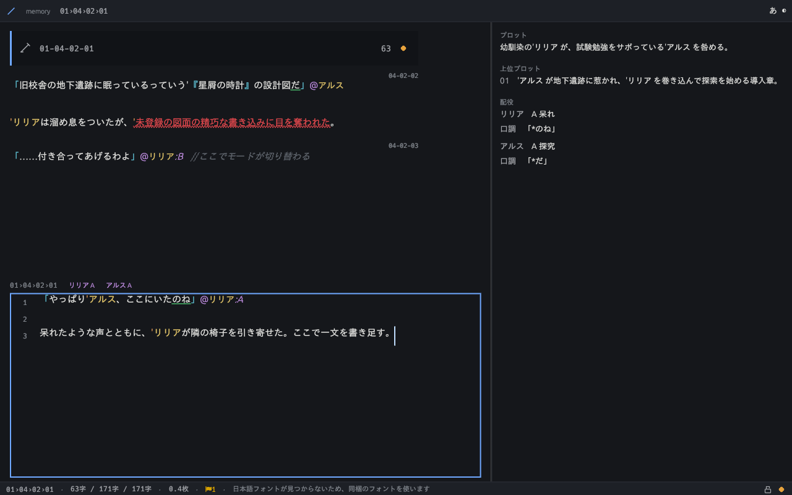

# novnow — Next-Generation World-Building Management Systems

`novnow` is a suite of tools designed to cultivate and expand your own fictional worlds—whether for full-length novels, light novels, web fiction, visual novels, or scenario scripts.

The novnow editor, built to manage the novnow format, runs both as a desktop application (Windows / macOS / Linux) and in the browser (WebAssembly + IndexedDB). The layout and the keyboard bindings are the same on both, and the same project opens in either.

## Where it runs

| Way to run it | Setup | Best for |
|---|---|---|
| **Browser** (no install) | Open `https://novnow.sonneko.com/app/` | Trying it first, keeping your machine clean |
| Desktop (Windows / macOS / Linux) | Releases are in preparation ([how to install](./docs/users/install.md#desktop)) | Managing manuscripts in a local folder |
| Command line (CLI) | Same as above | Checking and exporting a whole manuscript at once |
| Editor integration (LSP) | Same as above | Writing in VS Code or another editor |
| AI integration (MCP) | Same as above | Letting AI read and propose changes |
| Python | `pip install novnow` (in preparation) | Automating your own workflow |
| VS Code extension | Install from the marketplace (in preparation) | Writing in VS Code every day |

The layout, the keys, and what gets saved are the same in the browser and on the desktop.
Whichever door you use, you get the same result from one shared implementation.

Start with the [user guide](./docs/users/README.md), or go straight to [Getting Started](./docs/users/start.md).



---

## What is the novnow format?

The "novnow format" is a file format designed to manage the world-building and story that live inside your mind.

Just as PDF is a format for managing documents, novnow is a format for managing fictional universes. Simply by sending a novnow file, you can communicate your entire world to others.

It is also ideal when multiple creators want to build a single shared world together.

Furthermore, it supports extensions designed to convey your world directly to AI systems.

## What does it look like in practice?

- Character modes and role-language (speech-style) settings
- Terminology glossary
- Idea stockpiles
- Manuscript text
- Overall plots, chapter plots, and episode plots
- Reference materials
- Character icons

All of the above information can be integrated and managed in one place.

For example, manuscript text is written like this:

```
@01-04-01 The Library After School
The 'Magic Academy library was dead silent. Soft afternoon sunlight filtered through the gaps between bookshelves that reached up to the high ceiling.
In a corner scented with aged parchment, 'Ars had a thick grimoire open before him.

@01-04-02 Confrontation in the Library
"I knew you'd be here, 'Ars."@Lilia

With an exasperated voice, 'Lilia pulled up an adjacent chair.
Her neatly brushed silver hair swayed as she peered down at the book in 'Ars's hands.

"You know final exams start tomorrow, right? The 'Headmaster said anyone with failing marks this time will be stuck in remedial classes all break."@Lilia
;
"I know. But take a look at this."@Ars

'Ars pointed his fingertip toward an intricate magic circle drawn on the parchment.

"It's a blueprint for the 'Stardust Clock—the one said to be sleeping in the underground ruins of the 'Old School Building. If this is real, we can prove the existence of lost ancient alchemy."@Ars
;
"Not another one of those dubious rumors..."@Lilia

'Lilia let out a sigh, but as her eyes were drawn to the blueprint's exquisite detail, the words died in her throat.
'Ars did not miss the small spark of curiosity igniting in her blue eyes.
;
"...So, do you really plan on going there?"@Lilia
"Today after school, right when the 'Old School Building is left unlocked. You're coming too, aren't you, 'Lilia?"@Ars
"...I'll come along. I can't have you getting lost, after all."@Lilia

Saying so, 'Lilia looked away, the corners of her lips curling upward ever so slightly.
```

The "novnow format" is designed to leave no room for ambiguity on the reader's part.

The novnow format includes a feature to export your novel as plain text data. All format-specific symbols can be stripped away with a single click.

In the future, following continued research and development, we plan to implement export features for various media beyond novels, such as visual novels and 3D CG animation.

## Summary of Editor Specifications

1. **Focused Writing Centered on 1 Section as the Smallest Unit (`write` workspace)**
   - The "Section Editor" in the lower pane lets you focus solely on the section you are writing, while the "Context View" above it shows up to 3 preceding and following sections read-only.
   - The reference pane on the right automatically extracts and shows the plot, characters (active modes and speech styles), terms, materials, and diagnostics that concern the current section. Its visibility, side, and split ratio are all keyboard-adjustable.
2. **Lightweight Proprietary Text Syntax and Lossless Saving**
   - Manuscript text (`contents/AA-BB.txt`), overall and chapter plots (`plots/all.txt`, `plots/AA.txt`), episode plots (`plots/AA-BB.txt`), characters (`characters.md`), terms (`words.md`), ideas (`ideas.md`), and materials (`materials/`) are all plain text (UTF-8), so Git diffs them natively.
   - Not a single byte of the original is discarded: what you read is what is written back. A project is self-contained around `project.json`; only the `.novnow/` cache stays out of version control.
3. **Semantic Resolution Engine and 76 Types of Real-Time Diagnostics**
   - Provides glossary resolution via `'Name` (shortest match, NFKC normalization), situation-aware character mode resolution, speech-style pattern matching (tone matches are underlined in green), detection of terms used before their first appearance, and authoring diagnostics for sentence length, repeated sentence endings, spelling variance, and more.
   - Every one of the 76 diagnostics has a stable code (`E001`-`W0xx` / `I0xx`), reachable through the `Ctrl+.` quick fix and the `review` workspace.
4. **Keyboard-Driven 9 Workspaces and a Unified Palette**
   - Switch instantly between manuscript (`write`), episode plot (`plot-episode`), outline (`plot-outline`), ideas (`idea`), materials (`material`), cast (`cast`), reader (`reader`), agents (`agent`), and review (`review`) with `Alt+1` through `Alt+9`. The current section is preserved across the switch.
   - The unified palette (`Ctrl+P`) jumps anywhere in the project by prefix (`@` structure, `'` dictionary, `#` materials, `>` commands). `Ctrl+G` jumps by scene number, `F5` reloads, and `?` lists every shortcut.
   - The UI is available in Japanese and English (`Ctrl+Alt+L`), with a system-aware dark/light theme (`Ctrl+Alt+T`).
5. **Human-Controlled AI Agent Integration (MCP Compatible)**
   - Set one of 4 delegation levels (`off` / `propose` / `apply` / `autonomous`) per role (`writer`, `plotter`, `ideator`, `researcher`, `stylist`, `logician`, `integrator`). Proposals become part of the manuscript only after a diff review.
   - `novnow mcp <dir>` exposes the project to external AI clients as an MCP server with 14 tools. Prompts and ContextPackets are assembled deterministically with a character budget.
6. **Annotation-Stripped Export**
   - Strips authoring headers, comments, `'` references, and material tags to produce plain text (`.txt`) or Markdown (`.md`) for publishing platforms and vertical-text viewers.
   - Whole projects can be exported to and imported from a Zip archive.

---

## Install and Run

Distribution covers 10 desktop builds (with or without a window, across 5 OS/CPU targets), 5 Python wheels, a VS Code extension, and a GitHub Action (publication is in preparation). See [how to install](./docs/users/install.md) for users and [distribution.md](./docs/distribution.md) for the release procedure and rules.

Until then, novnow can be built from source. A stable Rust toolchain is required.

```bash
git clone https://github.com/sonneko/novnow.git
cd novnow

# CLI only (no GUI crates, so it builds quickly)
cargo build --release

# Desktop GUI included
cargo build --release --features ui
```

```bash
# Create a project (then check it, then export it)
NOVNOW=./target/release/novnow
$NOVNOW new my-novel
$NOVNOW check my-novel
$NOVNOW export my-novel --format txt --out manuscript.txt

# Open the GUI (a directory, or --gui for the picker)
$NOVNOW my-novel
$NOVNOW --gui
```

The bundled sample runs with `./target/release/novnow check examples/sample-novel`. The web build is served locally with `trunk serve` (see [`GUIDE.md`](./GUIDE.md)).

---

## External Interfaces

Everything the GUI can do is also reachable headlessly (see [`interfaces.md`](./docs/specifications/interfaces.md)).

| Entry point | Start it with | What it gives you |
|---|---|---|
| CLI | `novnow new` / `check` / `export` / `import` / `migrate` / `api` / `mcp` / `lsp` | Create, check, export, migrate, and list the API. Uniform `novnow <domain> <verb> <dir>` form |
| LSP | `novnow lsp <dir>` | Completion, hover, go-to-definition, diagnostics, formatting, and folding for your editor (LSP 3.17) |
| MCP | `novnow mcp <dir>` | 14 tools for AI clients |
| Python | `import novnow` | The same 119 canonical operations from Python (PyO3, abi3-py39 wheel) |
| Rust | the `novnow` crate | The `core` and `app` APIs directly |

```bash
novnow api list             # list the 119 canonical operations (--json for machines)
novnow check my-novel       # print diagnostics and exit (exit code 5 when there are errors)
novnow structure tree my-novel --json                    # canonical operations accept --json
```

## About the Specifications

All specifications for the editor and the novnow format are fully documented:

- [`overview.md`](./docs/specifications/overview.md): Design principles, terminology, and architecture
- [`project.md`](./docs/specifications/project.md): Project structure, `project.json`, and sample layouts
- [`syntax.md`](./docs/specifications/syntax.md): Syntax specifications for each file
- [`semantics.md`](./docs/specifications/semantics.md): Dictionaries, shortest-match, mode resolution, and role-language pattern language
- [`diagnostics.md`](./docs/specifications/diagnostics.md): Diagnostics catalog
- [`editing.md`](./docs/specifications/editing.md): Section-based editing, auto-save, external change conflicts, and change proposals
- [`ui.md`](./docs/specifications/ui.md): Screen specifications, workspaces, themes, and internationalization
- [`platform.md`](./docs/specifications/platform.md): Storage boundaries, Web IndexedDB, and CLI startup specifications
- [`agent.md`](./docs/specifications/agent.md): AI agents, delegation levels, MCP, and prompt specifications
- [`workflows.md`](./docs/specifications/workflows.md): Material collection, export, and performance/quality requirements
- [`interfaces.md`](./docs/specifications/interfaces.md): CLI, LSP, MCP, Python, and Rust interfaces
- [`external.md`](./docs/specifications/external.md): Distribution formats (10 desktop builds, 5 wheels, a VS Code extension, and a GitHub Action)

Our website ([https://novnow.sonneko.com/](https://novnow.sonneko.com/)) has a feature guide, the full diagnostics catalog, and an API reference. The specifications themselves live in this repository under [`docs/specifications/`](./docs/specifications/) and are versioned with the implementation.

To contribute, start with [`GUIDE.md`](./GUIDE.md) (build and writing walkthrough) and [`docs/developers.md`](./docs/developers.md) (dev environment, document rules, and verification).

## About the License

novnow is free for anyone to use. It will never become a paid service.

Both the "novnow format" specifications and the "novnow editor" source code are freely available under the `MIT License`.
