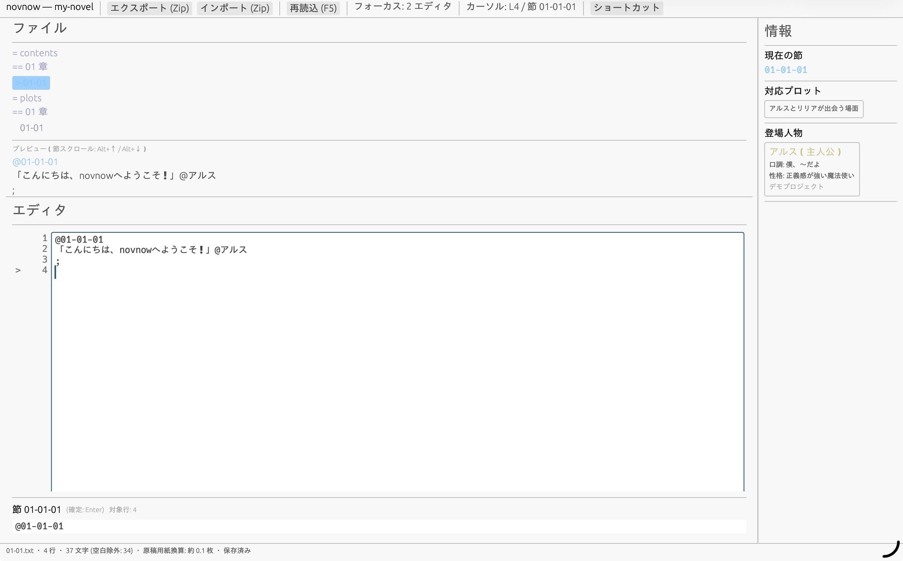

# novnow - あなたの世界を効率的に描くための専用IDE

このアプリケーションは、長編小説やシナリオを「章・話・場面・節」という単位で管理しながら執筆できる、作家向けの専用デスクトップツールです。Windows・MacOS・Linux・Webに対応しています。

普通のテキストエディタやワードプロセッサとは違い、プロットと本文が常に連動し、キャラクターや用語の設定が書きながら自動で参照できるのが特長です。マウスを使わず、キーボードだけで素早く構造の中を移動しながら書くことを前提に設計されています。

AIエージェント機能も組み込まれていますが、人間向けの機能がメインです。AIと人間がどのように作業を折半するかはあなたが完璧にコントロールできます。

---

## このツールでできること

### 1. 構造化された執筆
物語を「A章・B話・C場面・D節」という単位で管理します。例えば「01-04-02-03」という番号で、1章4話2場面3節に瞬時にジャンプできます。長大な原稿も、構造を頭に入れたまま書き進めることができます。このIDEの全ての機能は、「節」単位で動きます。

### 2. プロットと本文の連動
右側のパネルには、今書いている場面に対応するプロット（あらすじ）が自動で表示されます。「この場面で何を書くべきか」を確認しながら執筆できるため、物語の軸がブレにくくなります。脳内のワーキングメモリを減らし、本文の執筆に集中することができます。

### 3. 設定資料の自動参照
キャラクターの名前にカーソルを合わせると、その人物の性格や口調が右に表示されます。特殊な用語があれば、用語説も自動で引かれます。本文を書きながら別ファイルを開いて確認する手間が省けます。シングルクオテーションを打つと、用語・キャラ名が予測補完されます。スペルミスをすることも、長い用語があっても快く執筆できます。

### 4. 資料の一元管理
Webで見つけた参考資料などを、プロジェクト内に構造化して保存できます。必要な時にすぐに参照・引用できます。検索・保存のステップはAIに「これについての情報を集めておいて！」というように丸投げすることもできます。

### 5. 最新のAIエージェントワークフローシステムによる段階的自動化
プロット・本文・アイデア・資料検索・文体チェック・論理的整合性チェック、全作業の統合を6つの役割を1節単位でAIに与えることができます。あなたの執筆計画の管理だけをAIにしてもらうことも、本文やプロットは全てあなたが書きAIにアイデアだけ量産してもらうことも、小説ひとつ丸ごとAIに作ってもらうことも、プログラムのように本文を予測補完し執筆を効率化することもできます。あなたは、あなたのするべきことをするだけです。

---

## 画面の構成

画面は3つの領域に分かれています。

### 左上：ファイルリーダー
プロジェクト内のファイル一覧と、現在開いてい本文の全体像が表示されます。ここでは閲覧がメインで、編集は左下で行います。どの場面にいるのかが常に把握でき、キーボードでスクロールすることもできます。

### 左下：エディタ
実際に文章を書く場所です。画面下部には、Excelの数式バーのような「現在の節専用の編集欄」があります。ここで1節だけを集中して編集し、確定（EnterやCtrl+Enter）すると本文全体に反映されます。

行番号が左に表示されており、今自分がどの行を書いているが一目でわかります。

### 右：コンテキスト表示
カーソルの位置を読み取り、今最も必要な情報を自動で表示します。

- **プロット**：今の場面・話・章のあらすじ
- **キャラクター情報**：登場人物の性格・口調
- **用語解説**：この世界観特有の言葉の意味
- **資料**：関連する参考資料

優先順位は「カーソル行に直接関係あるもの > 同じ場面のもの > 同じ話のもの」です。

---

## はじめかた

### プロジェクトを開く
1. アプリケーションを起動します。
2. `Ctrl + O` を押して、物語のフォルダ（`[title]/`）を選択します。
3. 必要なファイル（`characters.json` や `words.json` など）が揃っていれば、自動的に読み込まれます。

※ もし必要なファイルがない場合はエラーが表示され、終了します。初めからプロジェクトを新規作成することも可能です。

使い心地を試してみたい場合は、Web版も利用できます。近日公開予定です。

### 基本的な執筆の流れ
1. 左上のファイルツリーから、書きたい場面（例`01-04.txt`）を選びます。
2. 左下のエディタに本文が表示されます。
3. 下部の節専用編集欄で文章を書き、確定します。
4. `Ctrl + S` で保存します。

---

## よく使う便利機能

| 操作 | ショートカット | 説明 |
|---|---|---|
| 場所にジャンプ | `Ctrl + G` | 「01-04-02-03」などの番号を入力して、その節に瞬時に移動します。 |
| プロットを開く | `Ctrl + B` | 今書いている場面のプロットファイルを開きます。 |
| 資料を探す | `Ctrl + M` | 今の場面に関連する資料を検索・表示します。 |
| 用語を登録 | `Ctrl + T` | 選んだ文字列を用語辞書（`words.json`）に新規登録します。 |
| キャラを登録 | `Ctrl + Shift + T` | 選んだ文字列をキャラ辞書（`characters.json`）に新規登録します。 |
| 設定を再読み込み | `F5` | 他のソフトで編集したキャラ設定や用語を再読み込みします。 |
| ファイル切替 | `Ctrl + Tab` | 最近開いたファイルを順番に切り替えます。 |

### ペイン間の移動
| ショートット | 移動先 |
|---|---|
| `Ctrl + 1` | 左上のファイルリーダー |
| `Ctrl + 2` | 左下のエディタ |
| `Ctrl + 3` | 右の情報パネル |
| `Ctrl + ↑ / ↓` | ファイルツリーとエディタ間のフォーカス移動 |

---

## ファイルの管理について

このツールは、専用のフォルダ構造を使ってデータを管理します。主要なファイルの役割は以下の通りです。

- `contents/`：**本文**（実際の小説の文章）が入っています。`01-01.txt` など、章・話ごとに分かれています。
- `plots/`：**プロット**（あらすじ・設計図）が入っています。本文と対になっており、場面番号で紐づいています。
- `characters.json`：**キャラクター設定**（名前・性格・口調など）の辞書です。
- `words.json`：**用語集**（世界観特有の言葉や固有名詞の解説）です。
- `materials/`：**資料**（参考にしたWebページのメモやイベント感想など）がっています。
- `ideas.json`：**アイデアメモ**（「後で使いたい設定」など）を貯めておく場所です。

これらのファイルは、本ツール以外のテキストエディタや表計算ソフトでも編集可能です。外部で変更を加えた場合、`F5` を押すと本ツール側も最新の内容に更新されます。

---

## 注意事項とトラブルシューティング

### 起動時にエラーが出る場合
以下のファイルがプロジェクトフォルダ内に存在しないと、正しく起動しません。

- `characters.json`
- `words.json`
- `ideas.json`
- `materials/index.json`
- `plots/index.json`
- `plots/preparations.json`
- `plots/all.txt`

ファイルが不足している場合は、新規プロジェクト作成機能を使うか、上記ファイルを準備してください。

### 保存について
- `Ctrl + S` は、現在編集中のファイルのみを保存します。
- `Ctrl + Shift + S` は、開いているすべてのファイルを一括保存します。

### 文字コードと改行
デフォルトではUTF-8（BOMなし）LF改行で保存されます。

---

## このツールの想定ユーザー

- 長編小説を構造的に管理したい作家
- プロットと本文を並行して管理したいシナリオライター
- キャラクター設定や用語を大量に持つファンタジー・SF作家
- マウスに手を伸ばすことなく、キーボードだけで素早く書き進めたい人
- 使うべきところにAIを使って、自分のするべき仕事は自分でしたいという人

---

*このツールは、あなたの物語世界を「描く」ことに集中できる環境を提供することを目指しています。*
